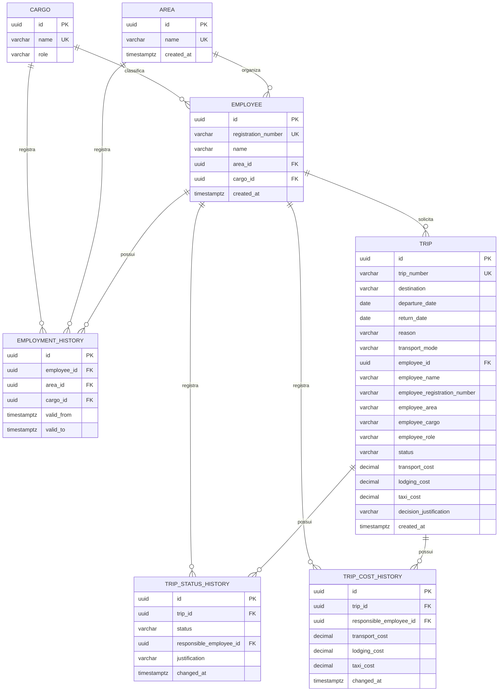

# MER | Sistema de Gestão de Viagens

## Modelo atual

## Regras de integridade

| Elemento | Regra aplicada |
|---|---|
| `cargos.role` | Aceita somente `COLABORADOR` ou `GESTOR`. |
| `employees.registration_number` | Matrícula única e obrigatória no formato `XXXX-X`. |
| `employment_history` | Mantém cargo e área ao longo do tempo, com no máximo um período aberto por empregado. |
| `trips.trip_number` | Número único obtido pela sequence PostgreSQL `trip_number_seq`. |
| `trips.employee_id` | Chave estrangeira obrigatória para o empregado solicitante. |
| Campos `employee_*` de `trips` | Snapshot do empregado no momento da solicitação. |
| Datas da viagem | `return_date` deve ser igual ou posterior a `departure_date`. |
| Custos | Valores não negativos; custo total é calculado pela aplicação. |
| `trip_status_history` | Registra cada mudança de situação e o empregado responsável. |
| `trip_cost_history` | Registra cada alteração de custo e o empregado responsável. |

## Numeração

A sequência `trip_number_seq` é incrementada diretamente pelo PostgreSQL. Isso evita que duas criações simultâneas obtenham o mesmo número, diferentemente do cálculo `MAX + 1` na aplicação.

## Relações principais

Uma área e um cargo podem estar associados a vários empregados. Cada empregado possui um histórico de alocações e pode solicitar várias viagens. Cada viagem mantém o snapshot do empregado, registra alterações de situação e mantém uma trilha específica para alterações financeiras.
