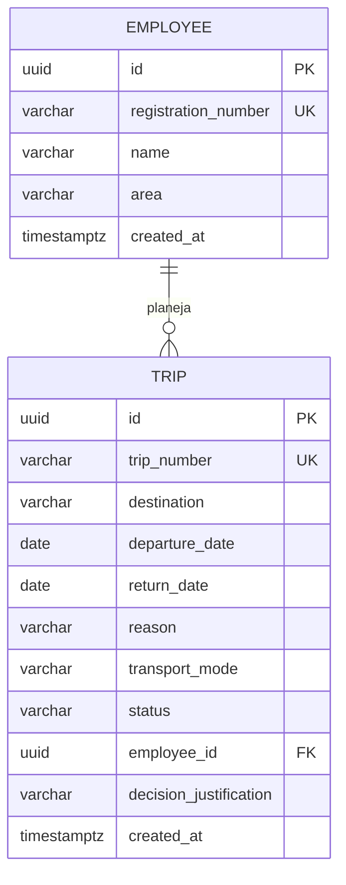

# MER | Sistema de Gestão de Viagens

## Entidades da Sprint 1

## Regras de integridade

| Elemento | Regra aplicada |
|---|---|
| `employees.registration_number` | Matrícula única e obrigatória. |
| `trips.trip_number` | Número único gerado por sequência do banco. |
| `trips.employee_id` | Chave estrangeira obrigatória para `employees.id`. |
| Datas da viagem | `return_date` deve ser igual ou posterior a `departure_date`. |
| Situação da viagem | Valor obrigatório controlado pela aplicação. |

## Relação principal

Um empregado pode planejar nenhuma ou várias viagens. Cada viagem pertence a exatamente um empregado cadastrado.
