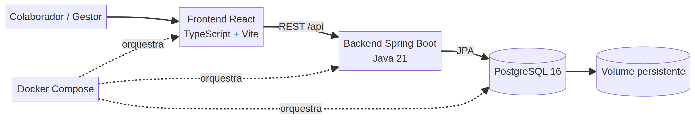

# Arquitetura do SGV | Sprint 1

> **Princípio de solução:** separar interface, regras de negócio e persistência para permitir evolução organizada do Sistema de Gestão de Viagens.

## Visão da solução

O SGV executa em três serviços integrados pelo Docker Compose. A interface React consome a API Spring Boot por `/api`; a API aplica regras de negócio e persiste empregados e viagens no PostgreSQL.



## Componentes e responsabilidades

| Componente | Tecnologia | Responsabilidade | Acesso local |
|---|---|---|---|
| Interface web | React, TypeScript, Vite e Nginx | Cadastro de empregados, planejamento de viagens e acompanhamento das situações. | `http://localhost:5173` |
| API de negócio | Spring Boot e Java 21 | Aplicar validações, expor endpoints REST e controlar o fluxo da viagem. | `http://localhost:8080` |
| Banco de dados | PostgreSQL 16 | Persistir empregados, viagens, sequência de números e relações entre as entidades. | `localhost:5432` |
| Migrações | Flyway | Criar e versionar o esquema de dados a partir do backend. | Executado na inicialização da API |
| Orquestração | Docker Compose | Construir e executar os três serviços com variáveis locais. | `docker compose up --build` |

## Caminho da informação

```text
Usuário
   ↓
Interface React e Nginx
   ↓  API REST /api
Backend Spring Boot
   ↓  JPA e Flyway
PostgreSQL
```

## Persistência e acesso ao banco

O banco possui dois perfis locais. O usuário administrador definido por `POSTGRES_USER` executa as migrações Flyway. O usuário de aplicação definido por `POSTGRES_APP_USER` é usado pelo backend no acesso cotidiano às tabelas. As senhas ficam apenas no arquivo `.env`, que é ignorado pelo Git.

| Necessidade | Mecanismo adotado |
|---|---|
| Criar o usuário de aplicação | `database/init/01-create-application-role.sh` em volume novo do PostgreSQL. |
| Versionar tabelas e relacionamentos | Migração `V1__evolve_sprint0_schema_to_sprint1.sql` no backend. |
| Preservar dados entre reinicializações | Volume nomeado `postgres_data`. |
| Recriar o ambiente local | `docker compose down -v` seguido de `docker compose up --build`. O primeiro comando remove os dados locais. |
| Recuperar uma baseline de sprint | Tag Git `sprint-<número>` e backup lógico do banco, quando necessário. |

## Endpoints principais

| Método | Endpoint | Finalidade |
|---|---|---|
| `GET` | `/api/employees` | Consultar empregados cadastrados. |
| `POST` | `/api/employees` | Cadastrar empregado com matrícula, nome e área. |
| `GET` | `/api/trips` | Consultar viagens e empregados associados. |
| `POST` | `/api/trips` | Registrar viagem como Rascunho. |
| `POST` | `/api/trips/{id}/submit` | Submeter viagem em Rascunho. |
| `POST` | `/api/trips/{id}/decision` | Aprovar ou rejeitar uma viagem submetida. |

## Estado atual

Na Sprint 1, a interface React consome os endpoints reais da API. O backend valida os dados obrigatórios, exige empregado cadastrado, confere o período, gera o número único da viagem e controla as situações. A validação integrada com Docker Compose deve ser executada no ambiente local com Docker Desktop.

Para atualizar um ambiente local que ainda utiliza um volume criado na Sprint 0, recrie o volume antes da primeira execução da Sprint 1. Essa etapa permite que o script de inicialização crie o usuário de aplicação e que o Flyway aplique a evolução do esquema em uma base limpa de desenvolvimento.
