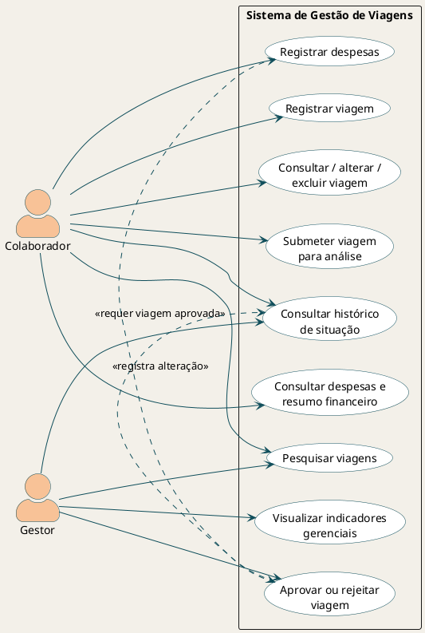

# UC01 - Registrar viagem

> **Jornada priorizada:** permitir que o colaborador transforme uma necessidade de deslocamento em uma solicitação de viagem organizada e pronta para análise.

| Elemento | Definição |
|---|---|
| **Ator principal** | Colaborador |
| **Objetivo** | Registrar uma viagem corporativa na situação inicial de **Rascunho**. |
| **Prioridade** | Alta |
| **Valor entregue** | O colaborador passa a ter uma solicitação estruturada, consultável e preparada para o fluxo de aprovação. |

---

## Contexto da jornada

O registro de viagem é a porta de entrada do fluxo do SGV. Nesta etapa, o colaborador informa as características essenciais da viagem e o sistema valida se a solicitação possui dados suficientes para ser acompanhada posteriormente.

> **Situação inicial garantida:** toda viagem registrada inicia como **Rascunho**. Ela poderá ser revisada antes de ser submetida ao gestor.

> **Estado do demonstrador na Sprint 0:** a interface ilustra esta jornada com estado local. O contrato equivalente já existe na API, mas a chamada entre frontend e backend ainda não foi integrada.

---

## Pré-condições

| Condição | Responsável |
|---|---|
| O SGV está disponível para o registro de viagens. | Sistema |
| O colaborador possui os dados necessários para o planejamento. | Colaborador |

---

## Fluxo principal

| Etapa | Ação | Resultado esperado |
|---|---|---|
| **1** | O colaborador seleciona **Nova viagem**. | O sistema inicia uma nova solicitação. |
| **2** | O sistema apresenta o formulário de cadastro. | Os campos necessários ficam disponíveis para preenchimento. |
| **3** | O colaborador informa destino, período, motivo, transporte e responsável. | A solicitação reúne os dados essenciais da viagem. |
| **4** | O colaborador confirma o registro. | O sistema recebe a solicitação para validação. |
| **5** | O sistema valida os dados informados. | Campos e período são conferidos conforme as regras de negócio. |
| **6** | O sistema cria a viagem como **Rascunho**. | A viagem entra no fluxo do SGV sem ser submetida ainda. |
| **7** | O sistema apresenta a viagem registrada. | O colaborador pode consultar o registro e prepará-lo para submissão. |

---

## Tratamento de exceções

| Código | Situação identificada | Resposta esperada do sistema |
|---|---|---|
| **FA01** | Um campo obrigatório não foi informado. | Destacar os campos que precisam ser preenchidos antes da conclusão. |
| **FA02** | A data de retorno é anterior à data de saída. | Informar que o período da viagem é inválido. |
| **FA03** | Ocorre uma falha ao registrar os dados. | Informar que o cadastro não foi concluído e preservar uma comunicação clara ao usuário. |

---

## Resultado da jornada

Após o fluxo principal, a viagem é armazenada como **Rascunho** e fica disponível para consulta. A próxima decisão do colaborador é revisar a solicitação ou submetê-la para análise do gestor.

```text
Cadastro concluído → Rascunho → Consulta ou submissão para análise
```

---

## Casos de uso relacionados

| Código | Jornada relacionada | Ator principal | Continuidade do UC01 |
|---|---|---|---|
| **UC02** | Consultar viagem | Colaborador | Permite revisar as informações registradas. |
| **UC03** | Submeter viagem para análise | Colaborador | Altera a situação de **Rascunho** para **Solicitada**. |
| **UC04** | Decidir solicitação de viagem | Gestor | Aprova ou rejeita uma viagem submetida. |

---

## Dados necessários para o cadastro

| Dado | Obrigatório | Por que é necessário |
|---|---:|---|
| Destino | Sim | Identifica onde a viagem será realizada. |
| Data de saída | Sim | Define o início do período planejado. |
| Data de retorno | Sim | Define o fim do período e viabiliza a validação do intervalo. |
| Motivo | Sim | Registra a finalidade corporativa da viagem. |
| Meio de transporte | Sim | Caracteriza o planejamento do deslocamento. |
| Responsável | Sim | Identifica quem responde pela solicitação. |

---

## Visão do exemplo técnico



O diagrama apresenta os quatro casos de uso expostos pelo exemplo técnico. A fonte editável está disponível em [diagrama-caso-de-uso.puml](diagrama-caso-de-uso.puml).
