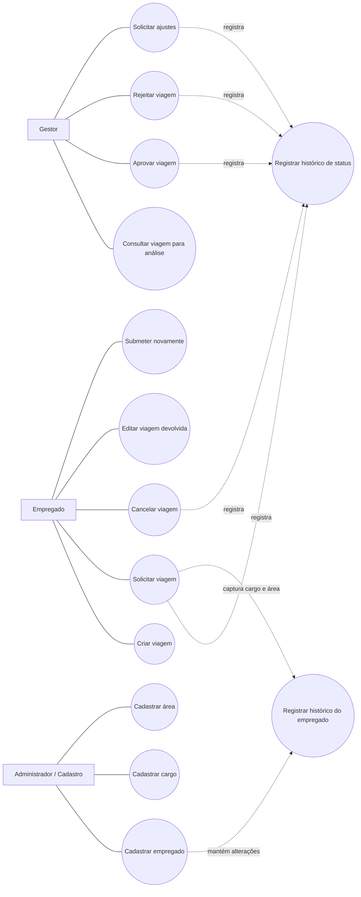

# Diagrama de Casos de Uso : SGV

## Atores

| Ator                       | Responsabilidade                                   |
| -------------------------- | -------------------------------------------------- |
| **Empregado**              | Solicita, cancela e corrige suas próprias viagens. |
| **Gestor**                 | Analisa e decide sobre viagens solicitadas.        |
| **Administrador/Cadastro** | Mantém empregados, cargos e áreas.                 |

---

## Diagrama

---

## Observação

O histórico de status é consequência das operações de mudança de status. O histórico do empregado é mantido quando cargo ou área são alterados e é consultado para preservar o contexto profissional da solicitação.
